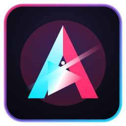

# 🌟 Aniyomi Cross (Multiplataforma PC & Android)

<p align="center">
  
</p>

<p align="center">
  <b>La plataforma definitiva todo-en-uno para ver Anime y leer Manga / Manhwa / Webtoons 100% en Español.</b><br>
  Disponible de forma nativa para <b>Teléfonos Android (APK)</b> y para <b>Computadoras (Windows PC)</b>.
</p>

<p align="center">
  <a href="https://github.com/Gabriel48772/aniyomi-cross/releases"></a>
  
  
</p>

---

## 📥 CENTRO DE DESCARGAS OFICIAL

| Plataforma | Archivo de Descarga | Tipo | Instrucciones Rápidas |
| :--- | :--- | :--- | :--- |
| 📱 **Android (Teléfono)** | [📥 **Descargar APK para Teléfono**](dist/AniyomiCross-Android.apk?raw=true) | `.apk` (v1.3.4) | Descarga en tu celular y pulsa "Instalar". |
| 💻 **PC (Instalador Windows)** | [🚀 **Descargar Instalador para PC**](dist/Instalador-AniyomiCross-PC.bat?raw=true) | `.bat` / `.ps1` | Descarga y haz doble clic para instalar con acceso directo e icono. |
| 💻 **PC (Ejecutable Directo)** | [📦 **Descargar Ejecutable .jar**](dist/AniyomiCross-PC.jar?raw=true) | `.jar` portable | Ejecuta directamente con doble clic o con `run-pc.bat`. |

> [!TIP]
> **Para usuarios de PC**: Recomendamos descargar el **[Instalador para PC](dist/Instalador-AniyomiCross-PC.bat?raw=true)**. Creará automáticamente los accesos directos en tu Escritorio y en tu Menú Inicio con el logo oficial de Aniyomi Cross.

---

## 🆕 Novedades de la Versión 1.3.4

1. **Corrección Crítica de Cierre Inesperado (Crash) en Móvil**:
   - Se resolvió la falla donde la app se cerraba sola al presionar ver cualquier capítulo de anime.
   - Protección integral de hilos en WebView y ExoPlayer: bloqueo de esquemas externos no controlados (`intent://`, `market://`), captura segura de JavaScript alerts/dialogs y aislamiento en el ciclo de vida de Jetpack Compose con aceleración de hardware activa.
2. **Corrección del Botón "Abrir en Navegador"**:
   - Ahora el botón "Navegador 🌐" normaliza automáticamente el enlace, añade la bandera de actividad nueva (`FLAG_ACTIVITY_NEW_TASK`) y abre el selector universal del sistema con opciones para Chrome, Brave, Firefox, VLC o el reproductor preferido.
3. **Descargas 100% Reales en MP4**:
   - Se implementó un extractor inteligente para resolver streams multimedia reales (`.mp4` o `.m3u8`) a partir de enlaces de servidores y páginas web (Mediafire directo, Voe, Streamwish, JKanime).
   - Verificación estricta de formato: descarta páginas de error HTML y garantiza archivos de video válidos y reproducibles sin conexión.
   - Diagnóstico visible del estado de descargas en tiempo real.

---

## 🛠️ Estructura del Proyecto

```text
aniyomi-multiplatform/
├── core/                       # Núcleo compartido (Multiplataforma)
│   ├── model/                  # Modelos de datos (MediaItem, VideoSource, MangaPage)
│   ├── network/                # Cliente OkHttp con DNS Bypass (8.8.8.8 / 1.1.1.1)
│   ├── scrapers/               # Fuentes directas (AnimeFLV, JKanime, MonosChinos, ZonaTMO, etc.)
│   └── updater/                # Gestor de auto-actualizaciones desde GitHub
├── app/                        # Aplicación Android (Jetpack Compose & Media3 ExoPlayer)
│   └── src/main/
│       ├── res/drawable/       # Iconos adaptive oficiales
│       └── res/mipmap-*/       # Iconos PNG de alta resolución para launcher
├── desktop/                    # Aplicación para PC (Java Swing & Reproductor Cinema 1080p)
│   └── src/main/resources/icons/ # Iconos oficiales .ico y .png
├── dist/                       # Artefactos finales listos para descargar
│   ├── AniyomiCross-Android.apk # APK para celulares Android
│   ├── Instalador-AniyomiCross-PC.bat # Instalador para Windows
│   ├── AniyomiCross-PC.jar     # Ejecutable para PC
│   ├── icon.ico                # Icono para Windows
│   └── icon.png                # Logo oficial
└── installer/
    └── setup.ps1               # Script de instalación gráfica para Windows
```

---

## 💻 Compilación desde Código Fuente

Si deseas compilar los ejecutables tú mismo:
```bash
./gradlew.bat :desktop:fatJar :app:assembleDebug
```
Los archivos resultantes se ubican en:
- PC: `desktop/build/libs/desktop-all.jar` -> `dist/AniyomiCross-PC.jar`
- Android: `app/build/outputs/apk/debug/app-debug.apk` -> `dist/AniyomiCross-Android.apk`
